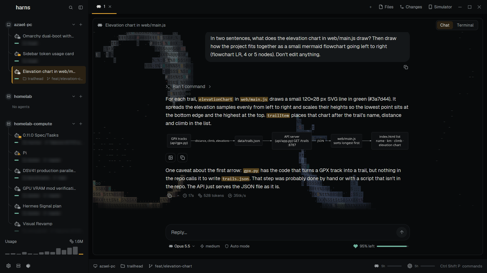
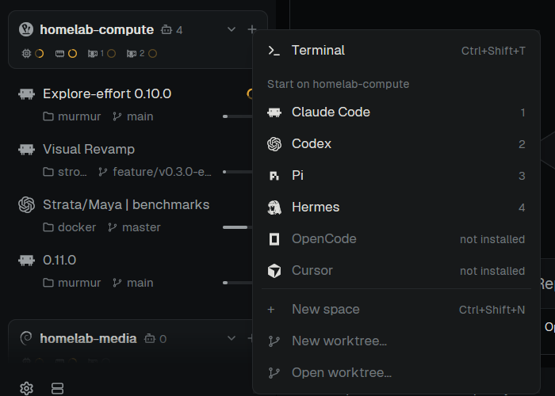
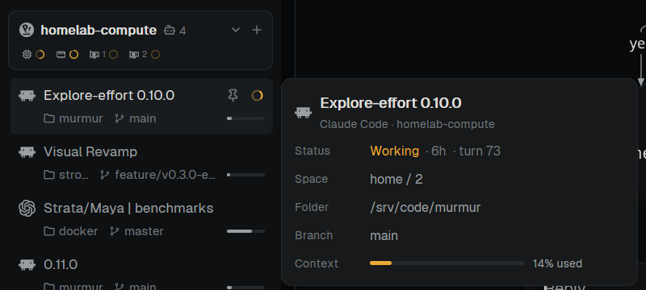
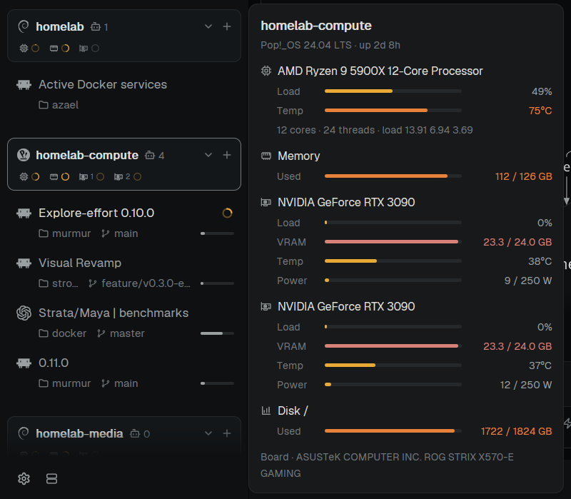
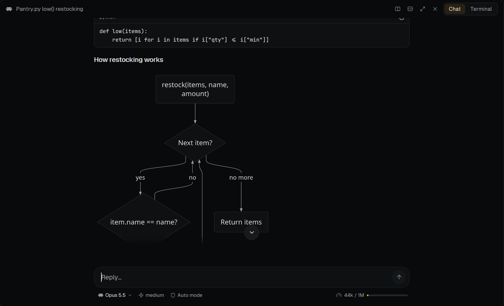
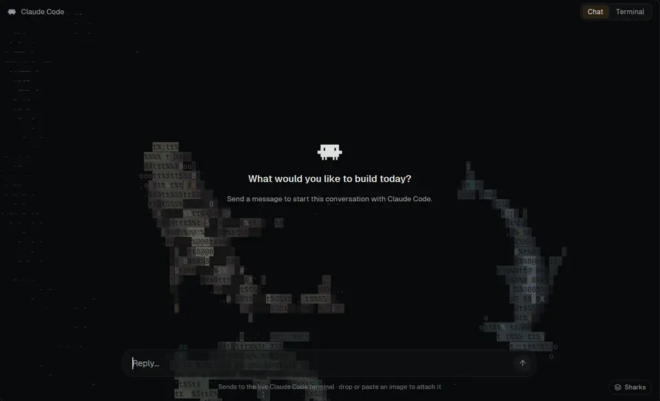
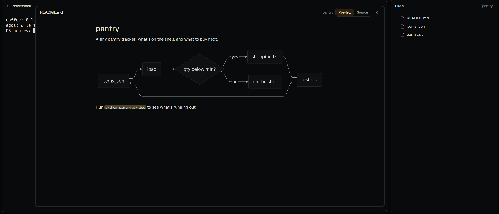
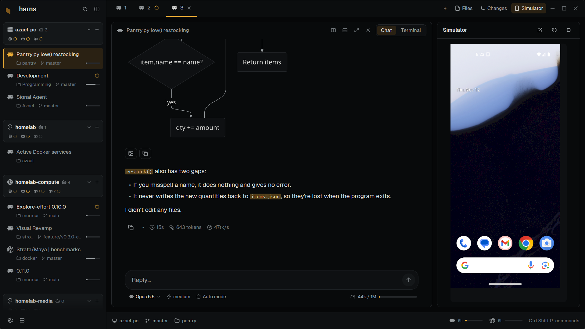

# harns

Layouts and mods for the [Herdr](https://herdr.dev) app, in one repository:

| Listing | What it is | Folder |
|---|---|---|
| **harns** (layout) | A window organized by machine: each machine's agents in the sidebar, agent tabs as a chat or a terminal, Claude Code and Codex quota in the status bar | [`layouts/harns`](layouts/harns/RECIPE.md) |
| **herdr-chat** (layout) | An agent's terminal shown as a chat, with a Chat / Terminal toggle | [`layouts/herdr-chat`](layouts/herdr-chat/RECIPE.md) |
| **agent-chat** (mod) | The chat and its Chat / Terminal toggle, for your own layout | [`mods/agent-chat`](mods/agent-chat/RECIPE.md) |
| **markdown-files** (mod) | herdr's Files panel, with Markdown opening rendered in a floating window | [`mods/markdown-files`](mods/markdown-files/RECIPE.md) |

Each folder is one listing on herdr.dev: its `RECIPE.md` (the brief to build it from), its `preview.png`, and the files
an agent copies to add it. The rest of this page is about harns.

harns is a herdr layout organized by machine: each machine's CPU, RAM and GPU load and its agents in the sidebar, agent
tabs as a chat or a terminal, and Claude Code and Codex quota in the status bar. Everything goes through herdr's own
machine connections.

[Its RECIPE.md](layouts/harns/RECIPE.md) describes it in full, as a brief to build it from.

## Features

**Organized by machine.** Each machine in the sidebar lists its agents with their folders, branches and context, and
its plain terminals, hanging from it on lines; the Classic style boxes each machine with its system (Windows, macOS or
the Linux distribution) and its CPU, RAM and GPU load, which the machine's card shows in either. Its **+**
starts an agent there from the ones installed on it, or a terminal, a new space or a worktree. Alt+Up and Alt+Down
walk the agents; Alt+Shift+Up and Alt+Shift+Down jump to the next machine's. Alt+Left and Alt+Right
switch an agent's tab between Chat and Terminal.

**Details on hover.** Rest on an agent for its status, space, folder, branch and context window, or on a machine for
its system, CPU, memory, GPUs and disks.

**A chat for every agent.** An agent's tab is a chat ([agent-chat](mods/agent-chat/RECIPE.md)) or its live terminal,
one click apart. Mermaid diagrams in replies are drawn by [Pele](https://github.com/obsidianmd/pele).

**Something to look at.** A dimmed animation plays behind the chat: sharks, jellyfish, a night sky or rain. It's lively
behind a new conversation's welcome, and slow and faint behind a conversation, out of the way of the text.

**Markdown, rendered.** Click a Markdown or `.mmd` file in the Files panel ([markdown-files](mods/markdown-files/RECIPE.md))
and it opens rendered in a floating window, with its images and mermaid diagrams. The files an agent's reply links to
sit under it in the chat, and open in the same window.

**An Android emulator per session** (Windows and Linux). The Simulator panel runs one beside each agent, shared with the machine
the agent runs on (below).

The status bar shows where you are (machine, folder, branch, and the branch's open pull request, a click away) and the
Claude Code and Codex quota left.

**Settings of its own.** The harns logo in the sidebar's footer opens harns's Settings: this computer's name, the
sidebar's style (Tree, agents hanging from their machine on lines, or Classic, each machine boxed with its agents and
stats), where token usage shows (a strip of daily columns under the agents, or a small one in the footer; rest on it for
two weeks by day and harness, across every machine), whether agents open as a chat, where a new agent session starts
(Chat or its terminal), the chat's animated background (on or off, and which scene), what the status bar shows, and
whether the tab bar offers the Simulator. Drag a machine's band to reorder the machines in the sidebar.

## Install

Needs the Herdr app, and Python 3 on each machine. Ask your agent to add the harns layout, or from a clone run
`./install.sh` (on Windows, `python scripts/install.py` in PowerShell).

The installer copies harns into `~/.config/herdr-app` (or `HERDR_APP_HOME`), adds its program icons and keys to yours
without replacing any you set, sets up the context relays on this computer (below), checks every mod and switches to
`harns`; `ctrl-shift-l` switches back. A `harns` layout you changed is kept beside the new one as
`harns.json.before-install-<time>`. Options: `--no-switch`, `--no-relays`, and `--no-chat` to leave an installed
agent-chat as it is.

For a nickname instead of the computer's own name, set Name in harns's Settings (General).

## Context bars

Each agent's card shows how full its context window is. Claude Code's and Pi's come from a relay, Codex's from its log
(or its footer, when `context-remaining` is one of its `tui.status_line` items); the Claude Code and Codex quota bars
need no relay. The installer sets the relays up on this computer; for another machine, run
`python scripts/install-context.py --on MACHINE`. They write:

- `~/.config/harness/context-relay.py`, with the snapshots it keeps in `context/` beside it;
- `~/.pi/agent/extensions/harness-context.ts` (Pi sessions already running pick it up after `/reload`);
- `statusLine` in `~/.claude/settings.json`, backed up once as `settings.json.before-harness-context`. A status line
  you had is kept in `~/.config/harness/claude-statusline-original.json`, and the relay still runs it.

## Simulator

On Windows and Linux, the panel beside Files and Changes runs an Android emulator for each session (an agent's tab and
its sub-agents), from the Android SDK (`ANDROID_HOME`, else its default folder). [RECIPE.md](layouts/harns/RECIPE.md)'s
"Simulator setup" lists what to install. The panel shows the focused session's emulator in place (on Windows and under
Hyprland; elsewhere each opens in its own window) and keeps the others running hidden. Stop saves where Android was,
Restart boots it fresh with its apps and data, and closing a tab stops its emulator. The iOS Simulator needs a Mac.

Each emulator gets 4 GB of RAM, 4 cores and the graphics card, as limits rather than reservations. Change them in
`~/.config/herdr-app/harness.json`, which updates don't overwrite:
`{ "emulator": { "default": { "memory": 6144 }, "devices": { "harns_phone": { "cores": 6 } } } }` (`memory` in MB,
`cores`, `gpu`; `devices` by virtual device name).

A session on another machine reaches its emulator with that machine's own `adb`: the panel shares it there over an SSH
reverse tunnel on that machine's localhost (on Windows, ssh to it needs to work with a key; Linux reuses herdr's
connection) and installs a small `~/.local/bin/adb` that points each session at its own emulator, so `adb install` and
`expo run:android` work as usual. An `adb` there that isn't harns's is left alone.

## Platforms

| | CPU and RAM | GPUs | Simulator |
|---|---|---|---|
| Windows | PowerShell counters | NVIDIA | In the panel |
| Linux | Python 3, `/proc` | NVIDIA | In the panel on Hyprland, else its own window |
| macOS | Python 3, `top` and `vm_stat` | — | — |

Each machine's platform is detected once (`src/shared/platforms.js`). GPU vendors
are entries in `src/shared/gpus.js`, with a place for AMD, Intel and Apple.

## Working on it

- Each mod's source is in `src/`; what several share (code, and the one icon set in `src/shared/icons/`) is in
  `src/shared/`, and a mod gets what it imports or names when it's built. The listings' `mods/` folders are built
  from it by `scripts/package.py`: don't edit them. Edit `src/`, then run the installer (`--no-switch --no-relays`
  while developing): it builds the listings and copies harns's into `~/.config/herdr-app`.
- A listing is a folder under `layouts/` (or, for a mod on its own, `mods/`) with its `RECIPE.md`, `preview.png` and
  files; `package.py`'s `LISTINGS` says which mods each one ships.
- Check with `herdr-app check <mod folder>`, `herdr-app status` and `herdr-app shot`.
- Tests: `npm test` runs them all (the Python unit tests, harns's and the chat's Node and Python tests, a check that
  the vendored Pele matches its pin, after `npm install` byte for byte, and a check that every listing is built from
  the current `src/`). A few of the chat's tests need Linux or macOS and say they're skipped on Windows. It finds Python 3
  as `python3`, `python` or `py -3`, so it runs as installed on Windows, Linux and macOS. The
  stats and account probes are tested the way each platform runs them: PowerShell on Windows,
  Python on Linux and macOS.
- agent-chat and markdown-files share one vendored copy of Pele. To update it, change the pin in `package.json`, then
  run `npm install && npm run vendor:pele`.
