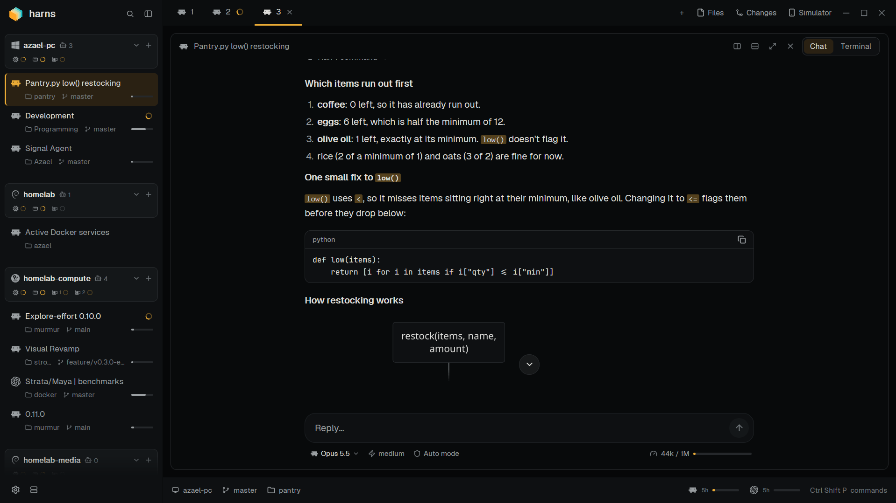
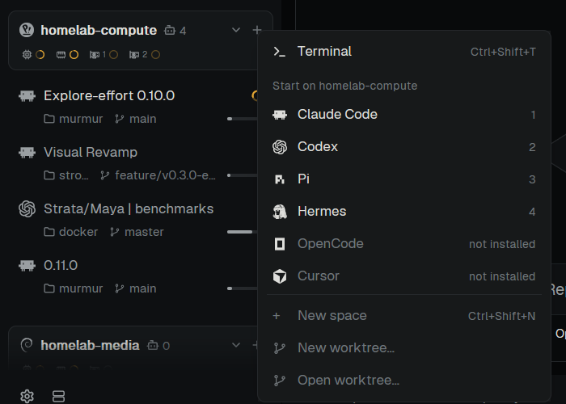
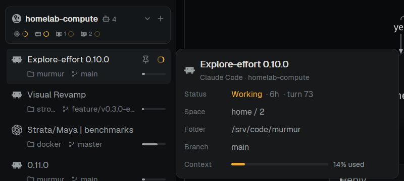
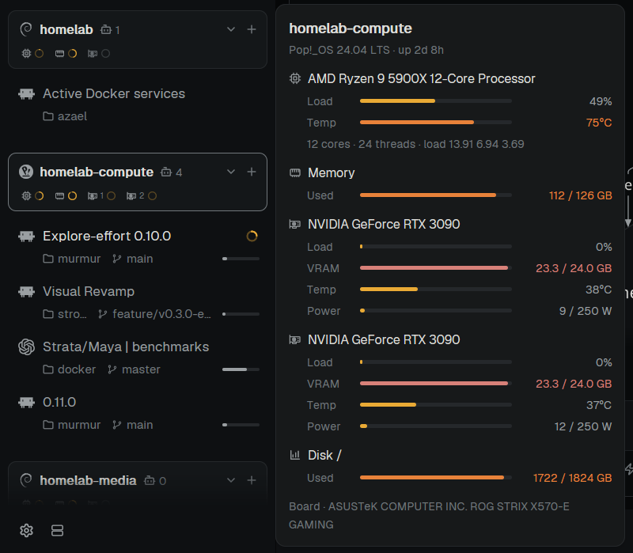
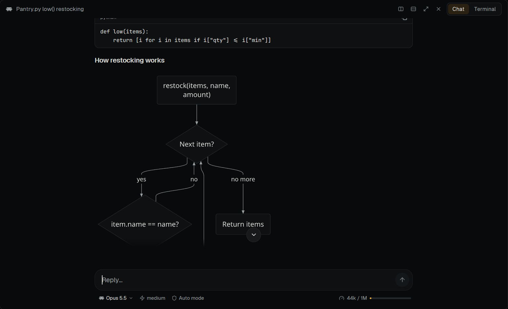
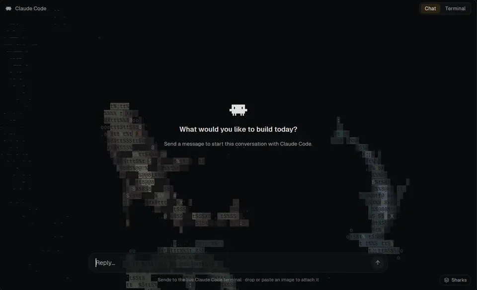
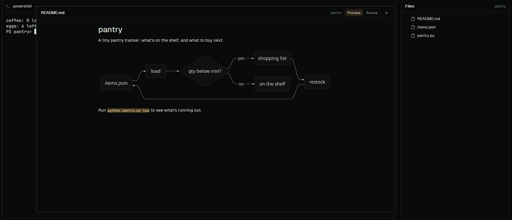
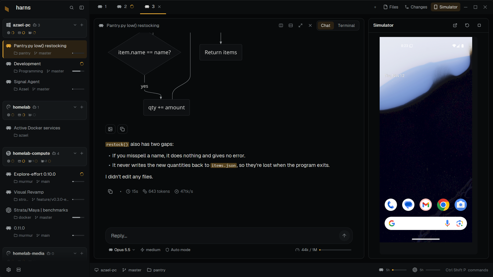

# harns

A herdr layout organized by machine: each machine's CPU, RAM and GPU load and its agents
in the sidebar, agent tabs as a chat or a terminal, and Claude Code and Codex quota in the
status bar. Everything goes through herdr's own machine connections.

[RECIPE.md](RECIPE.md) describes it in full, as a brief to build it from.

## Features

**Organized by machine.** Each machine in the sidebar shows its system (Windows, macOS or the Linux distribution),
its CPU, RAM and GPU load, its agents with their folders, branches and context, and its plain terminals. Its **+**
starts an agent there from the ones installed on it, or a terminal, a new space or a worktree. Alt+Up and Alt+Down
walk the agents; Alt+Shift+Up and Alt+Shift+Down jump to the next machine's.

**Details on hover.** Rest on an agent for its status, space, folder, branch and context window, or on a machine for
its system, CPU, memory, GPUs and disks.

**A chat for every agent.** An agent's tab is a chat ([herdr-chat](https://github.com/azaeldrm/herdr-chat)) or its
live terminal, one click apart. Mermaid diagrams in replies are drawn by [Pele](https://github.com/obsidianmd/pele).

**Something to look at while it starts.** A new conversation opens on a dimmed animation behind its welcome: sharks,
jellyfish, a night sky or rain.

**Markdown, rendered.** Click a Markdown or `.mmd` file in the Files panel and it opens rendered in a floating
window, with its images and mermaid diagrams.

**An Android emulator per session** (Windows). The Simulator panel runs one beside each agent, shared with the machine
the agent runs on (below).

The status bar shows the Claude Code and Codex quota left.

## Install

Needs the Herdr app and Python 3 on each machine. The chat in agent tabs is
[herdr-chat](https://github.com/azaeldrm/herdr-chat): the installer adds it when it isn't
installed yet (`--no-chat` to skip) and never replaces a copy you have.

Ask your agent to add this layout, or run `./install.sh` from a clone (on Windows, from Git
Bash, or run `python scripts/install.py` in PowerShell, with the same options). It builds the
generated files, copies the mods, theme, assets and layout into
`~/.config/herdr-app` (or `HERDR_APP_HOME` when it's set), sets the icon and tint for Codex,
Claude Code and Pi in your `programs.json` (its other entries stay as they are), checks every mod,
installs this computer's relays (below) and switches to `harns` (`--no-switch` to
skip). `ctrl-shift-l` switches back. A `harns` layout you
changed is kept beside the new one as `harns.json.before-install-<time>`.

Optional:

- **Context bars** (on each agent's card) come from relays: Claude Code's status line and a Pi extension
  (`scripts/install-context.py`, on Windows, Linux and macOS). Codex's comes from its log
  (the one herdr-chat found for it), else its footer, when `context-remaining` is one of its
  `tui.status_line` items. The Claude Code and Codex
  quota bars read the account from each service and need no relay.
  The installer sets the relays up on this computer (`--no-relays` to skip);
  for each connected machine run `python scripts/install-context.py --on MACHINE`. They write:
  - `~/.config/harness/context-relay.py`, and the snapshots it keeps in `context/` beside it;
  - `~/.pi/agent/extensions/harness-context.ts`;
  - `statusLine` in `~/.claude/settings.json`, after copying the file to
    `settings.json.before-harness-context` once. A status line you had is kept in
    `~/.config/harness/claude-statusline-original.json`, and the relay still runs it;
  - in `~/.codex/config.toml`, only removing a `notify` line an older relay added.

  Pi sessions already running pick up the relay after `/reload`, typed in their terminal.
- **Simulator** (Windows): the panel beside Files and Changes runs Android virtual devices
  from the Android SDK (`ANDROID_HOME`, or `%LOCALAPPDATA%\Android\Sdk`). Create one first in
  Android Studio's Device Manager or with `avdmanager`. Each session (an agent's tab) gets its
  own emulator, and its sub-agents use the same one; when another session needs one, the panel
  copies a virtual device for it. The panel shows the focused session's emulator, its own
  window placed over the panel so it runs at full speed with its own input, and the others
  keep running, hidden. Stop saves where Android was, and the next Start resumes it; Restart
  (the circular arrow) shuts the emulator down and boots it fresh, keeping its apps and data.
  Closing a tab stops its emulator and keeps the device. For Expo apps,
  run `expo start` and open the dev build as usual. The iOS Simulator needs a Mac.

  Each emulator starts with 4 GB of RAM, 4 cores and the graphics card (`-gpu host`), over what
  its virtual device says; storage is the virtual device's own. These are limits rather than
  reservations: cores are threads Windows runs anywhere, and memory is taken as Android uses
  it (though memory Android has filled isn't given back until the emulator stops). The defaults
  are in `mods/harness-simulator/emulator.json`; change them in `~/.config/herdr-app/harness.json`,
  which updates don't overwrite, as `{ "emulator": { "default": { "memory": 6144 }, "devices":
  { "harns_phone": { "cores": 6 } } } }` (`memory` in MB, `cores`, `gpu`; `devices` by a virtual
  device's name, for that one only). The panel title's tooltip shows what the session's emulator
  uses. A new value applies the next time it starts; one the emulator wouldn't take is left out
  and named while it starts.

  Sessions on other machines reach their emulator with that machine's own `adb`. The panel
  shares each one there through an SSH reverse tunnel (Windows' OpenSSH, with the same ssh
  config as herdr's machines, so ssh to the machine needs to work with a key), listening only
  on that machine's localhost, and installs a small `~/.local/bin/adb` script there that points
  each session's terminals at their own emulator before running the machine's own adb. In
  that session, `adb devices` lists its emulator (and any phones, but not other sessions'
  emulators), and `adb`, `adb install` and `expo run:android` reach it. An `adb` already in
  `~/.local/bin` that isn't harns's is left alone. If that machine's adb server restarts, or a
  connection drops, the panel connects it again within a minute. A share that can't be set up
  (no ssh key, someone else's `adb` there) shows why and is tried again later, less and less often.
- **This computer's name:** it shows the computer's own name. For a nickname, put
  `{ "localMachineName": "my-pc" }` in `~/.config/herdr-app/harness.json`.

## Platforms

| | CPU and RAM | GPUs |
|---|---|---|
| Windows | PowerShell counters | NVIDIA |
| Linux | Python 3, `/proc` | NVIDIA |
| macOS | Python 3, `top` and `vm_stat` | — |

Each machine's platform is detected once (`mods/machine-stats/platforms.js`). GPU vendors
are entries in `mods/machine-stats/gpus.js`, with a place for AMD, Intel and Apple.

## Working on it

- Edit the sources in a clone, then run the installer (`--no-switch --no-relays` while
  developing). It runs `scripts/build-mods.py`, which writes the copies herdr needs (see
  RECIPE.md, Watch out), and copies the result into `~/.config/herdr-app`.
- Check with `herdr-app check <mod folder>`, `herdr-app status` and `herdr-app shot`.
- Tests: `npm test` runs them all (the Python unit tests, the Node tests, and a check that the
  vendored Pele matches its pin; after `npm install` it compares every byte). It finds Python 3
  as `python3`, `python` or `py -3`, so it runs as installed on Windows, Linux and macOS. The
  stats and account probes are tested the way each platform runs them: PowerShell on Windows,
  Python on Linux and macOS.
- `harness-files` is herdr's Files panel where Markdown and `.mmd` files open in a floating window as a readable
  document: images (beside the file or on its machine; web images show as links, never fetched) and
  mermaid blocks drawn by Pele (the same pinned version as herdr-chat). Preview and
  Source in its header switch views. To update Pele, change the pin in `package.json`, then run
  `npm install && npm run vendor:pele`.
