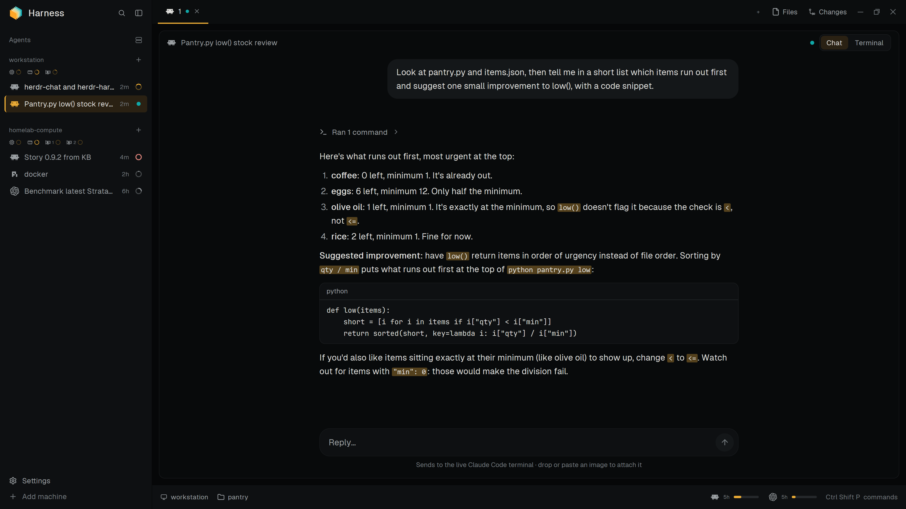

# harns

A dark, amber-accented herdr window organized by machine. The sidebar lists every
connected machine with live CPU, RAM and per-GPU load rings (hover it for a card of all its
details) and the agents running on it, each a two-line card with its session title, status,
folder and branch, and context used. Agent tabs open as a
chat (from [herdr-chat](https://github.com/azaeldrm/herdr-chat)) or their live terminal.
A status bar shows where you are and how much Claude Code and Codex quota is left.

Needs [herdr-chat](https://github.com/azaeldrm/herdr-chat) for the chat and the toggle: the
installer adds it, and adding this layout by hand means adding that repository's mod too.

To add it, run `./install.sh` from a clone (or `python scripts/install.py`). By hand, copy
more than the layout and its mods: `layouts/harns.json` with its picture
`layouts/harns.png`, every folder in `mods/` (the rings' images live in
`machine-stats`), `themes/harness.json` and `brand-assets/`, and merge `programs.json`'s
entries into yours.

## What you see

Left to right: a sidebar, then the work column. There's no system title bar.

- **Sidebar** (268 px, `surface` `#0e1012`; drag 44–480 px, or fold to a 56 px rail,
  76 px on macOS):
  - **Brand** (46 px, drags the window): the animated harns logo (28 px), "harns"
    (16 px semibold), then Search and the sidebar toggle.
  - **Agents:** grouped by machine, with no heading. Each group has the machine's name (this computer's own name, or
    a nickname), a + to start an agent there, a row of CPU, RAM and GPU rings (one per
    GPU, amber), then its agents. Each agent is a two-line card: the program icon, the
    session's own title (else its folder, else the tab name) and its status; under it, in
    11.5 px dim, its folder and git branch and a 36 × 3 px bar of the context window used
    (amber above 75%, red `#d88179` above 90%). Sub-agents hang under their parent as a
    tree (26 px rows).
    A machine with no agents says "No agents", "Connecting…" or "Offline".
  - **Footer** (44 px): two icons side by side, Settings (a gear, with an amber dot when an update is ready) and Add
    machine (a server).
- **Tab bar** (42 px, `chrome` `#0b0d0e`, drags the window): the space's tabs as labels
  with the program icon, the active one underlined in amber (2 px) with a close button;
  then +, Files, Changes, and the window buttons on Windows and Linux.
- **Work area** (12 px padding): the shown tab, as a chat (where a new agent session starts) or as terminal cards (10 px
  radius, 1 px `border`, a 42 px header with the Chat / Terminal toggle). Files or
  Changes open in a 368 px panel on the right.
- **Status bar** (42 px, `surface`): the shown space's machine and branch, the focused
  pane's folder, "N needs you" when agents on that machine are blocked, then Claude Code and Codex quota bars (44 × 4 px)
  and "Ctrl Shift P commands".

The theme is `harness`: background `#080a0b`, canvas `#060708`, text `#dededb`, accent and
working `#e9aa35`, done `#10a7a7`, idle `#80868b`, borders `#25282b`. Fonts are herdr's.

## How it behaves

- **Agent status**, in the sidebar: working is an amber ring spinning once every 900 ms;
  blocked is a "Needs you" badge (a "!" in the rail); done is a green check (the theme's
  `ansi2`); idle shows nothing, its context being the card's bar (the percentage on hover).
  Tabs show the same spinner, or a dot for blocked and done.
- **Context readings:** Claude Code and Pi report through the relays (Watch out). Codex's
  ring is its footer's "Context N% left", so it shows when `context-remaining` is one of
  Codex's `tui.status_line` items. A machine's readings are fetched when one of its agents
  finishes a turn, appears or goes away, or the machine comes online, and cleared while it's
  unavailable.
- **Logo:** it fades in and out while any agent is working and bobs up and down otherwise.
  Clicking it folds or unfolds the sidebar.
- **Sidebar:** clicking an agent focuses it; hovering a card shows a pin, and pinned
  agents sit in a Pinned group on top. Each machine keeps its own order: an agent that finishes, starts needing you or is new
  moves to the top, and dragging a card onto another of the same machine puts it there.
  A card that changes place slides there (280 ms, ease-out), and the ones it passes slide too.
  A machine's whole band (name and rings) folds its agents; parents with sub-agents fold too. A machine's + opens the agents
  installed there.
- **Details cards** (an agent's, a machine's) hang from the row's top-right corner, beside the
  sidebar: the first opens after 450 ms, and while one is up (or was, under 400 ms ago) moving to
  another row opens its card at once. A card closes 150 ms after the pointer leaves the row and the card.
- **Agent card:** resting on an agent's card opens a 340 px card beside the
  sidebar, level with it: the agent's name, program and machine; its status, for how long
  and its turn; its space and tab, full folder and branch; the context used as a bar; and
  its sub-agents, each with its status and for how long. Not while a card is being dragged.
- **Machine card:** resting on a machine's band opens a 340 px card level with it,
  beside the sidebar. Each part is a title (icon, name) and rows of label, a 148 px bar and the
  value, in fixed columns: CPU load and temperature (cores, threads and load averages under
  them), memory used, each GPU's load, VRAM, temperature and power against its limit (NVIDIA,
  through `nvidia-smi`; a GPU with no live readings is left out), each disk's use, and the
  motherboard. Bars are amber, orange (`#e8823a`) when high and red (`#d88179`) when near
  full: use from 80% and 95%, temperatures from 70 and 85 °C, power from 85% and 98% of its
  limit. It's read on the machine when the card opens and every 3 s while it's in use
  (Python 3 on Linux and macOS, PowerShell on Windows, where the CPU temperature needs
  administrator rights, so the card leaves it out).
- **Rings:** CPU, RAM and GPU refresh every second; hover one for its percentage. A ring
  stays empty until its first reading arrives.
- **Usage meters:** Claude's and Codex's limits belong to the account, so the bar shows one
  reading per service on every machine, from the service itself: Anthropic's OAuth usage
  endpoint with Claude Code's login, and `codex app-server`'s `account/rateLimits/read`. Each
  reading replaces the last (kept in shared `machine.usage` across restarts), so a usage reset
  shows at once. They're read when herdr starts, 2 s after a turn ends (seen in herdr's agent
  list: Claude Code's turn reads Claude, Codex's Codex, Pi's both) and every 15 minutes, for
  use outside herdr. They're asked on this computer, or on the first ready machine where the
  service is installed and signed in. A window past its reset reads 0%; a service signed out
  everywhere says so in the tooltip.
- **Tab bar:** click selects, double-click renames, drag reorders, right-click opens the
  tab menu, the scroll wheel moves between tabs. Files and Changes toggle the right panel,
  remembered per space.
- **Status bar:** each quota bar shows the 5-hour window and switches to 7 days while
  hovered, red above 90%; the tooltip gives the reset time. The last item opens the
  command palette.

## Built from

- **Layout** `layouts/harns.json`, cloned from `main`: root `row` (`titlebar:
  none`, theme `harness`, `terminal_padding [14, 12]`) → `sidebar` column [`brand`
  block, `sidebar-lists` column with the `agents` block, `sidebar-footer` block] and `work` column [`tabs` block,
  `work-body` row [`chat-view` stack of `chat-panel` and `terminal-panel`, hidden
  `panel` column with a `panel-body` stack of `files` and `changes`], `status` block].
- **Mods:**
  - `harness-chrome`: the brand bar, or the footer with props `{footer: true}`. Folds
    the sidebar with `layout.resize` and opens the shipped `picker` and `machine-add`.
  - `machine-agents`: the agents list, its machine cards and context bars. Calls `setAgentOrder`, `pane.focus` and `terminal.peek`.
  - `machine-metrics`: draws a machine's ring row (built into `machine-agents`).
  - `machine-new-menu`: the per-machine agent menu, from `knownAgents({on})`.
  - `harness-tabs`: the tab bar; uses the shipped `new-menu` and `menu`.
  - `workspace-status-machine`: the status bar. It also collects the stats: a built copy of
    `machine-stats` publishes shared `machine.stats`, `machine.usage` and
    `machine.local-label`.
  - `herdr-chat` (separate repo): the chat panel and the pane header with the toggle.
  - Shipped: the `changes` block; `picker`, `machine-add`, `new-menu`, `menu` and
    `worktree` as overlays; icons from `pane`, `files` and `changes`.
- **Programs it runs** through `exec(..., {on: machine})`: per platform
  (`machine-stats/platforms.js`) a PowerShell or Python 3 stats probe every second, the
  account probe above (an HTTPS request to Anthropic and a short-lived `codex app-server`),
  `nvidia-smi`, `uname -s` and `hostname`. Context rings read the relays' snapshots after
  turns end: this computer's directly (no process, as the relays write them), another
  machine's with `scripts/context-relay.py`'s collect() there; and Codex's footers with
  `hc read`.
- **Art:** `harness-logo-fade` and `harness-logo-bob` (WebP, SVG sources), monochrome SVG
  icons in `harness-chrome` and `machine-stats`, 101 generated context rings, Windows
  window icons in `harness-tabs`, program icons in `brand-assets/` and `programs.json`.

## Watch out

**What it accesses:**

- runs programs on this computer and on connected machines (`exec(…, { on })`): a PowerShell
  or Python 3 stats probe every second, `nvidia-smi`, `uname -s`, `hostname`, `hc read`, and
  for the usage meters a short-lived `codex app-server`;
- reads Claude Code's login (`~/.claude/.credentials.json`, or the `Claude Code-credentials`
  keychain item on macOS) and sends its token only to Anthropic's usage endpoint,
  `https://api.anthropic.com/api/oauth/usage`. That request and `codex app-server` are its only
  network use beyond herdr's own machine connections;
- reads the context snapshots the relays write in `~/.config/harness/context/` (session
  identifiers and context counts only; the relays send nothing anywhere), and files and Markdown
  shown in the Files panel (images beside a Markdown file are read from its machine; web images
  show as links and are never fetched);
- reads `harness.json` in the Herdr home for an optional nickname, and keeps its readings in
  shared `machine.*` values.

The installer writes only in the Herdr home, apart from the relays (see the README for the
files they add or change), and downloads herdr-chat from GitHub when it isn't installed.

**Notes for building it:**

- Each herdr mod imports from its own folder, so `scripts/build-mods.py` copies shared code:
  `machine-metrics` and `machine-stats`'s `details.js` (with what it runs on) into
  `machine-agents`, `machine-stats` into
  `workspace-status-machine`, `context-relay.py` into `context-probe.js`. Edit the
  sources and run it.
- The chat and the toggle need herdr-chat; without it those blocks show errors. The installer
  adds it from its repository when it's missing and never replaces an installed copy.
- Claude's and Pi's context rings come from the relays (`scripts/install-context.py`) on each
  machine: the installer sets them up on this computer, and `--on MACHINE` on the others.
  Pi's is a global extension publishing `getContextUsage()` every second; Claude's is the
  status line, keeping the session ID and `context_window` fields and passing the same input
  to a status line that was there before. Snapshots are keyed by `HC_TERMINAL_ID`, qualified
  with the machine name and checked against the terminal's creation time, never matched by
  folder. Claude reports no percentage early in a session; keep it unknown rather than 0%.
  `/reload` sent to Pi with `hc send` arrives as a message, so it's typed. The usage meters need only a machine where Claude Code and Codex are signed in. Claude's usage
  comes from Anthropic's OAuth usage endpoint with the `anthropic-beta: oauth-2025-04-20`
  header.
- Other machines need Python 3. GPU rings read NVIDIA cards through `nvidia-smi`; other vendors
  go in `machine-stats/gpus.js`, which has an entry for each.
- The installer is `scripts/install.py`; `install.sh` runs it with the first Python 3 that
  starts (on Windows, `python3` can be the Store placeholder), so install logic belongs in
  `install.py`.
- `harness-files` replaces herdr's `files` block (same block id, so its clicks survive). It is
  herdr's Files plus a Markdown view, and `vendor/pele` comes from `npm run vendor:pele`. Don't
  edit the vendored copy. With props `{ file }` it is a viewer for that one file.
- `harness-pane` is a pane header for layouts that want one; harns itself uses herdr-chat's.
- Sizes are read from the `sidebar` node's width: below 160 px every sidebar mod draws
  its rail.

## Done when

- `herdr-app check` passes for every mod and `herdr-app status` shows no errors.
- Each connected machine has a group with live CPU, RAM and GPU rings, and its agents
  under it; a working agent spins and the logo fades.
- Folding the sidebar leaves icons, rings and statuses centered in the rail.
- The status bar names the focused pane's machine and folder and fills the quota bars.
- A new Claude Code tab opens on its chat and toggles to Terminal from its header.
- Running the installer where herdr-chat isn't installed adds it; running it again leaves no layout
  backup behind.
