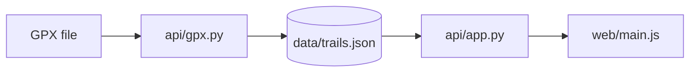

# trailhead

A small hiking log: a list of trails with their distance and climb, and an API that reads GPX tracks. Each trail
shows its elevation profile as a small chart.

## Run it

```sh
python api/app.py        # the API on http://localhost:8787
python -m unittest discover -s api
```

Then open `web/index.html`.

## How it fits together


