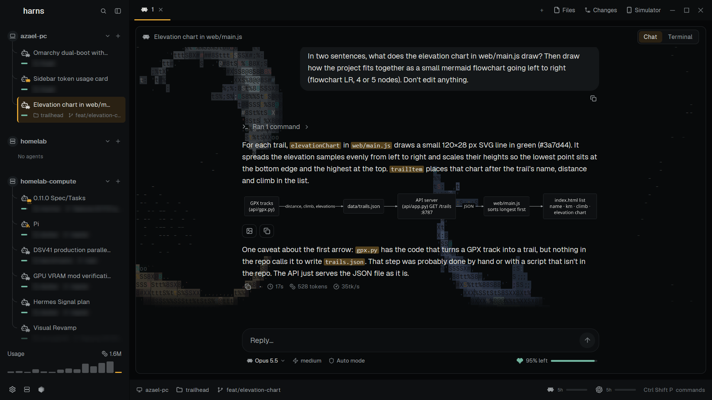

# harns

A dark, gray-accented herdr window organized by machine. The sidebar lists every
connected machine (hover it for a card of all its details; the Classic style adds live CPU, RAM
and per-GPU load rings) and the agents running on it, each a two-line card with its session title, status,
folder and branch, and context used. Agent tabs open as a
chat (from agent-chat, [the herdr-chat layout](../herdr-chat/RECIPE.md) too) or their live terminal.
A status bar shows where you are and how much Claude Code and Codex quota is left.

To add it, run `./install.sh` from a clone of the repository (or `python scripts/install.py`). By hand, copy
more than the layout and its mods, from this folder: `layouts/harns.json` with its picture `layouts/harns.svg` (the
sketch Herdr's layout picker shows), every folder in `mods/` (agent-chat's among them), `themes/harness.json` and
`brand-assets/`, merge `programs.json`'s entries into yours, and add `layouts/harns.keys.json` to your `keys.json` as
its `layout:harns` section.

## What you see

Left to right: a sidebar, then the work column. There's no system title bar.

- **Sidebar** (268 px, `surface` `#0e1012`; drag 44–480 px, or fold to a 52 px rail, twice its 26 px icon axis so what the rail centres lines up with the open sidebar's icons;
  76 px on macOS):
  - **Brand** (46 px, drags the window): the animated harns logo (28 px), "harns"
    (16 px semibold), then the home button, which shows Home. The logo folds the sidebar to the rail and back.
  - **Agents:** grouped by machine, with no heading. Each group has its system's icon (Windows, macOS, or the Linux
    distribution: os-release's ID, else its family, else Tux; Omarchy by its `~/.local/share/omarchy`; the BSDs by
    `uname`; Windows only when `cmd.exe /c ver` says so), asked each machine once a run and kept for the next, which shows
    it until the machine answers again (a drive or a screen before it ever has); the machine's name (this computer's own
    name, or a nickname; 13 px and gray like the icons, starting where its agents' titles do), a + to start an agent
    there, a row of CPU, RAM and GPU rings (one per GPU, in the accent), then its agents. Each agent is a two-line card: the program icon, the
    session's own title (without the harness's prefix, and the folder Pi and Codex add after it; else the
    program's name) and its status; under it, in 11.5 px dim, a 14 × 3 px bar of its context window under the icon, as on the
    rail, then its folder (the session's, from the log agent-chat found for it,
    shared `herdr-chat.paths`; else the pane's) and git branch. Sub-agents hang under their parent as a
    tree (26 px rows; in Tree their bot has no antenna, `harns-chrome/bot-small.svg`). In Tree the program's logo sits
    on the bot's corner on a halo of itself in the row's color (copies nudged 1 px each way), not a disc; a picture
    icon keeps the disc. Its terminals that aren't agents (a shell, a dev server, lazygit) follow its agents, a 28 px row
    each: the program's icon in the agents' icon column, the program running now and its folder; a click focuses it and
    shows the Terminal view; on the rail, just the icon, on the agents' axis, with the rest in its tooltip. The machine's
    name is followed by its counts, each with its icon: agents (a bot), and terminals (`>_`) when it has any.
    A machine with no agents says "No agents", "Connecting…" or "Offline".
    The list scrolls without a scrollbar; where more is out of sight, its top (under the logo) and bottom (over the
    footer) fade, as 32 px of 12 bands of `surface`. The position is followed from the wheel (a mod can't read it).
    That's the Classic style (shared `harness.sidebar` `classic`); the Tree style (the default) drops the band's box,
    system icon, rings and counts and hangs each machine's agents and terminals from its icon (a laptop or a server) on
    1 px lines, each agent's bot icon with its program's icon small at its corner. The machine's icon sits in a 22 px
    disc the colour of the band's hover, open and on the rail; the line starts under the disc and runs out of the band,
    drawn before it, so a hovered band covers both and only the icon stays. The icon's centre is where the rail centres
    it, so it doesn't move as the sidebar folds. In both, machines can be dragged into an order by their bands (kept in
    the mod's localStorage, `machines.order`).
  - **Past sessions**, below the machines: one row (a clock, "Past sessions", how many, a chevron), closed by default
    and closed again after a reload. Open, it's a search field, then every machine's Claude Code, Codex, Pi and OpenCode
    sessions not open as agents now, the last written first, under Today, Yesterday, This week and Earlier, 50 at first
    and "Show 50 more" after. Each is two lines: the harness's logo, the title (set by hand, else the harness's own, else
    the first typed message) and how long ago; then a chip with the machine (its icon and name) and the folder. Search
    looks for every word in the title, folder, machine and harness. Sub-agents (agents another one started with `hc run`)
    fold under the session that started them, or the one that started that: one entry, its title and `N sub-agents`
    (`, N running` while some still are), a chevron unfolding them, each reopenable on its own, and a click on the entry
    reopens that session. While that session still runs, its closed sub-agents wait under its name, tagged `running`
    and `N closed sub-agents`, and a click shows it. A search matching a sub-agent opens its group to the matches. The
    sidebar writes down which live terminal started which (hc's `parent`), in its localStorage `past.links`, kept 30
    days, and finds each one's log: the one the chat read for it, else the session that started in its folder soonest
    after it, within 2 minutes. Sub-agents from before this was written down stand alone. A click reopens it on its machine, in its folder,
    with the harness's resume command (`claude --resume <id>`, `codex resume <id>`, `pi --session <log>`, `opencode
    --session <id>`) after the program as that machine's `knownAgents()` starts it, as Home starts an agent: a tab in a
    space already there, else a new space. Each machine lists its newest 100, kept in the mod's localStorage (`past`),
    so the list shows at once, a reload included. An agent that closes joins the list as soon as it's gone, when its
    session was already kept. Opening the row reads the lists again, and so does every 30 s and each agent closing while
    it's open: `past_sessions.py` runs on this computer and every machine that's connected (`python3 -c`, standard
    library only, the start and end of each log), reading only the logs written since the newest one already kept;
    the rest come back as their path and time, and keep what was read of them before. Search looks through all of
    them, not just the ones shown. A machine that can't be reached keeps its last list, dimmed, its chip saying
    `offline`; clicking one says so. Nothing on the rail.
  - **Token usage** (shared `harness.usage`, Settings → Sidebar → Token usage): every harness's tokens on every machine,
    by day, in the time zone the app runs in. Fresh tokens (input, output, cache writes) make the numbers and columns;
    tokens read from the cache are in the card only. `strip` (the default): a row under the list, "Usage" with the token
    icon (coins) and today's tokens in gray over 14 columns, today's in the accent at the right. `footer`: no row; seven
    4 px columns, the token icon and today's tokens in gray at the footer's right end. Resting on either hangs a 320 px
    card beside the sidebar, in line with the work area: the last 14 days, newest first, each a bar split by harness (Claude Code `#d97757`,
    Codex `#8b9cf7`, OpenCode `#6cc4a1`, Pi `#d4b85c`) with its fresh and cached tokens, then the totals, the daily
    average, and any machine that couldn't be read. On the rail, with either setting, the bottom of the list shows the
    token icon and today's tokens in gray on top, as the Strip's, over five columns as tall as the Strip's (24 px)
    across the rail, centred on the icon axis, with the same card. The folded footer is one gear (with the update dot)
    opening a 210 px menu beside the rail, level with it: Settings, Add machine and harns settings; a pick, a press
    outside or Escape closes it (`Popover`). `machine-sidebar` reads every connected machine every 5 minutes, and at
    once when one connects unread, into shared `usage.tokens` (`token-usage.js`); a machine that fails or goes away
    keeps its last reading. The footer draws from the same reading.
  - **Footer** (44 px): Settings (a gear, with an accent dot when an update is ready), Add machine (a server), and
    harns's Settings (the logo, a 760 px dialog from `harns-settings`: General, Sidebar, Chat, Status bar, Simulator,
    which write shared `harness.colors`, `harness.local-name`, `harness.sidebar`, `harness.context-bar`, `harness.usage`,
    `herdr-chat.chat`, `herdr-chat.font`, `herdr-chat.default-view`, `herdr-chat.animation`, `herdr-chat.backdrop`,
    `harness.status`, `harness.quota.claude`, `harness.quota.codex`, `harness.commands-hint` and
    `harness.simulator`). A choice between options (the colours, the sidebar's style, its context bars, where token usage
    shows, where a new agent session starts, the chat's background) is a row of picture cards, as Herdr's
    settings show layouts: each a small live drawing of what it gives, the chosen one outlined in the accent with a check,
    and what it does under them. Where a new agent session starts is grayed, its cards unclickable, while Open
    agents as a chat is off. On/off settings are switches. The chat's background is a switch (Animated background)
    over a card per scene; each card's picture is a real frame of the scene, saved by `scripts/scene-previews.mjs` (`npm
    run previews`) into `harns-settings/scene-previews.js`, and the scenes' names come from
    `src/shared/backdrop-scenes.js`, which agent-chat plays from too. Picking a scene turns the background on.
- **Tab bar** (42 px, `chrome` `#0b0d0e`, drags the window): the space's tabs as labels (the name given to the tab,
  else the conversation title its agent sets, else the program's name) with the program icon, the active one underlined in the accent (2 px) with a close button;
  then +, Files, Changes, Simulator (Windows and Linux), and the window buttons on Windows and Linux.
- **Work area** (12 px padding): the shown tab, as a chat (where a new agent session starts unless its default
  view is Terminal) or as terminal cards (10 px radius, 1 px `border`, a 42 px header with the Chat / Terminal
  toggle). Files, Changes or Simulator open in a 368 px panel on the right.
- **Status bar** (42 px, `surface`): the shown space's machine, the focused pane's folder and its branch, that
  branch's open pull request (a PR icon in the accent, `#number` and its title, cut short), "N needs you" when agents on
  that machine are blocked, then Claude Code and Codex quota bars (44 × 4 px)
  and "Ctrl Shift P commands" (each can be turned off in harns's Settings, and the bar hidden).

Three themes share background `#080a0b`, canvas `#060708`, text `#dededb`, idle `#80868b` and borders `#25282b`,
and harns's Settings → General → Colours picks one (shared `harness.colors`, applied with `app.theme`):
- **harns** (`harness-color`): the logo, teal to orange. Accent teal `#5ccfcb`, selected `#10292a`, working yellow
  `#f8c55e`, needing you orange `#ffa422`, done mint `#72cabf`.
- **Monochrome** (`harness`, the default): grays throughout, accent `#c4c8ca`, selected `#24282b`, working near white
  `#eceeef`. Only signals keep colour: needing you (a question) red `#d88179`, done (a check, a finish) green `#6cc48a`.
- **Lively** (`harness-lively`): green to red, each agent in its own colours. Accent amber `#e9aa35`, selected
  `#2a2113`, working amber, needing you red `#d88179`, done green `#6cc48a`.

In Monochrome, animated orbs take the place of the logo, the agents' bots and the spinners: the brand bar's logo is a
listening wave. In the sidebar (Tree) an orb stands in for each agent's bot, and its program's logo moves off it to
the start of the card's bottom line, before the folder (on the rail, which has no such line, it stays on the orb; a
sub-agent's row shows it before its name):
while it works its own orb (one of working, searching, solving, connecting or weaving, picked from its address), while
it needs you a listening orb (the red "Needs you" stays on the right), and while it's idle or done a breathing one (the
done check stays on the right). Classic keeps its icons and shows the orbs as the right-hand marks. The spark
before a working agent's activity in the chat is that agent's orb, and Home shows a large shaping orb above its heading.
The logo hop and the logo-carried marks give way to them. Each orb is a loop of 60 frames a second, prerendered into a
sprite sheet (`orbs/` in each mod that shows them, from `src/shared/orbs`, laid out as `orb-clips.js` says): its own
small view shows the sheet through a window one frame wide, at the frame one shared clock is on, so drawing a frame is
placing one picture, and a redraw of the sidebar (a hover) can't set it back, as it would an animated WebP, which herdr
starts over whenever its view redraws. `scripts/render-orbs.py` draws the sheets from the vendored thinking-orbs engine
with round antialiased dots at twice the size they're shown: each loop runs to where its orb comes back closest to its
start (once round, for a motion that repeats), and crossfades its last second into its first frame. Home's large
shaping orb is drawn live instead (`live-orb.js`, agent-chat carrying the engine): its 24 dots are round boxes placed
where the engine puts them, redrawn every 16 ms, since herdr placed a large sheet a pixel or two off from frame to
frame and the orb shook.

What a theme file can't hold comes from `tones.js`, by the family a theme's accent names (the logo's teal is harns, a
gray is Monochrome, any other is Lively, so a mod outside harns keeps its colours): the range bars blend along from
empty to full (context, health and quota bars, the chat's context meter: harns teal → mint → yellow → orange,
Monochrome gray climbing to its whitest white `#eceeef` at 85% and only then turning red, Lively green → amber →
orange → red), the machine card's warn and full marks, the token-usage series (the logo's panels, grays, or each
agent's own) and today's column in the usage sparkline (Monochrome's whitest, else the accent), the chat backdrop's
highlights, and whether program icons show their own colours (Lively) or one tint. Settings' Monochrome card previews
only its grays, the red being an alarm rather than part of its scale. Terminal contents and code syntax keep the terminal palette.

herdr keeps the pick in `layouts/.state/`, across restarts and installs; at start the brand bar also swaps one harns
theme for the other when it doesn't match the choice (`harns-colors.js`), leaving a theme from herdr's own menu alone.
Fonts are herdr's, set in its Settings; the conversation alone can take another in harns's Settings → Chat →
Font (shared `herdr-chat.font`, `chat-font.js`): Default (herdr's), the three fonts herdr ships, a few readable ones the
system has (Segoe UI, Verdana and Georgia on Windows), or any installed font typed by name.

## How it behaves

- **Agent status**, in the sidebar: working is a ring in the theme's working colour spinning once every 900 ms;
  blocked is a "Needs you" badge (a "!" in the rail); done is a check in the theme's done
  colour; idle shows nothing open (the card's bar under the icon shows its context) and, on the rail, the same
  14 × 3 px context bar. It fills with the share used, coloured along the theme's range, or, with shared
  `harness.context-bar` `health` (Settings → Sidebar → Context bar), drains like a health bar to the share left, coloured
  the same way; hovering it gives the percentage either way. The chat's context meter under the
  reply box follows the same choice (`context-bar.js`, shared by both): with the health bar it shows a pixel heart
  (`heart-pixel.svg`, 7 × 6 squares) in the bar's color and "N% left", and drains in those colors, its tooltip keeping
  the tokens in use; with the fill, tokens used of the window, filling along the theme's range. On the
  rail the mark sits on the row's second line, under the icon.
  With the Health bar (Tree), the program logo carries the status instead: working, it hops in the working colour from side to side
  over the bot in a round arc (even pace across, easing up and down), a ripple ring of that colour spreading where it lands
  (`harns-chrome/ripple.svg`, an oval stretched as it grows). The sidebar drives it, one beat per half hop, each step
  a native transition and a fresh ring each landing, so ring and landing never drift apart. Each logo counts its hops
  from the beat it started working on, so logos that started on different beats land on alternate beats and head
  different ways. Above the logo, on its own
  halo: the done check (until it's looked at) or a question mark in the needing-you colour (`harns-chrome/question.svg`,
  blocked; the logo keeps the working colour). So there's no spinner, check or "Needs you" badge; on the rail every agent's second line is its
  context bar; names and icons are gray but for the agent in front's, white. A working sub-agent's logo hops over its
  bot too, and its name stays gray; the hop's places scale with the icon (16 px agents, 14 px sub-agents).
  Tabs show the same spinner, or a dot for blocked and done.
- **Context readings:** Claude Code and Pi report through the relays (Watch out). Codex's
  reading is its log's newest `token_count` (last input tokens of the model's window), from the
  log agent-chat found for it (shared `herdr-chat.paths`); else its footer's "Context N% left",
  when `context-remaining` is one of its `tui.status_line` items and the terminal is wide enough
  for Codex to show it. A machine's readings are fetched when one of its agents
  finishes a turn, appears or goes away, or the machine comes online, and cleared while it's
  unavailable.
- **Logo:** it fades in and out while any agent is working and bobs up and down otherwise.
  Clicking it folds or unfolds the sidebar.
- **Sidebar:** clicking an agent focuses it; its right-click menu pins it (Pin to top), and pinned
  agents sit in a Pinned group on top. Each machine keeps its own order: an agent that finishes, starts needing you or is new
  moves to the top, and dragging a card onto another of the same machine puts it there.
  A card that changes place slides there (280 ms, ease-out), and the ones it passes slide too.
  Alt+Down and Alt+Up (`agent.next`, `agent.prev`) walk the agents in the list's order: Pinned, then
  each machine top to bottom. Alt+Shift+Down and Alt+Shift+Up jump to the next or previous machine's top
  agent, coming round past the last (`machine-sidebar.next-machine`, `.prev-machine`). Alt+Left and Alt+Right show
  the agent's Chat or Terminal (`layout.select` on the `chat-view` stack; agent-chat follows). These keys are
  `layouts/harns.keys.json`; the installer adds each to keys.json's `layout:harns` section unless that keystroke is
  bound there already, and keeps the old file as `keys.json.before-install-<time>` when it changes. Without a
  keys.json (Herdr not opened yet) it adds none and says so.
  A machine's whole band (its name, and in Classic its rings) folds its agents; parents with sub-agents fold too. Right-clicking a connected machine's
  band opens its menu: New chat… (Home, on that machine) and New terminal, in its home folder (a tab
  in its active space; a machine's home is asked once with `hc exec` and kept in shared state, `harness.machine.homes`),
  then under New terminal in, its folders (the open ones, then the remembered ones, at most 8) and, on this computer,
  Browse… for any other.
- **Details cards** (an agent's, a machine's, the token usage) hang from the row's top-right corner, 12 px out from the
  sidebar, in line with the work area's window, on the sidebar's background (`surface`): the first opens after 900 ms, and while one is up (or was, under 400 ms ago) moving to
  another row opens its card at once. A card closes 150 ms after the pointer leaves the row and the card.
- **Agent menu:** right-clicking an agent opens a menu at the pointer (`agent-menu.js` says what each item does): Open
  chat, Open terminal, Peek; Send a message… (a small box at the pointer: Enter sends it with `hc send`, as if typed in
  its terminal, and you stay where you are) and Interrupt (`hc interrupt`); Pin to top, Rename… (its tab), Copy folder
  path and New session here (Home, on its machine with its folder chosen); and Close
  session…, which closes a tab the agent has to itself (herdr
  asks) or else asks, then ends it and its sub-agents. A sub-agent's menu has Peek, the two to talk to it, and Close.
  Opening it closes the row's details card, which stays shut until the pointer leaves the row.
- **Agent card:** resting on an agent's card opens a 340 px card beside the
  sidebar, level with it: the agent's name, program and machine; its status, for how long
  and its turn; its space and tab, full folder and branch; the context used as a bar; and
  its sub-agents, each with its status and for how long. Not while a card is being dragged.
- **Machine card:** resting on a machine's band opens a 340 px card level with it,
  beside the sidebar. Each part is a title (icon, name) and rows of label, a 148 px bar and the
  value, in fixed columns: CPU load and temperature (cores, threads and load averages under
  them), memory used, each GPU's load, VRAM, temperature and power against its limit (NVIDIA,
  through `nvidia-smi`; a GPU with no live readings is left out), each disk's use, and the
  motherboard. Bars are the accent, then the theme's warn and full colours (`tones.js`) when high and when near
  full: use from 80% and 95%, temperatures from 70 and 85 °C, power from 85% and 98% of its
  limit. It's read on the machine when the card opens and every 3 s while it's in use
  (Python 3 on Linux and macOS, PowerShell on Windows, where the CPU temperature needs
  administrator rights, so the card leaves it out).
- **Rings:** CPU, RAM and GPU refresh every second; hover one for its percentage. A ring
  stays empty until its first reading arrives.
- **Usage meters:** Claude's and Codex's limits belong to the account, so the bar shows one
  reading per service on every machine, from the service itself: Anthropic's OAuth usage
  endpoint with Claude Code's login, and `codex app-server`'s `account/rateLimits/read`. Each
  reading replaces the last (kept in shared `machine.usage` across restarts), so a usage reset
  shows at once. They're read when herdr starts, 2 s after a turn ends (seen in herdr's agent
  list: Claude Code's turn reads Claude, Codex's Codex, Pi's both) and every 15 minutes, for
  use outside herdr. They're asked on this computer, or on the first ready machine where the
  service is installed and signed in. A window past its reset reads 0%; a service signed out
  everywhere says so in the tooltip.
- **Tab bar:** click selects, double-click renames, drag reorders, right-click opens the
  tab menu, the scroll wheel moves between tabs. Files, Changes and Simulator toggle the right
  panel, remembered per space. + opens the new session dialog. Clicking a tab, or a row in the sidebar, leaves Home.
- **Home** (the work area's `home` screen, from the brand bar's home button, and shown by itself while no space is
  open): the chat's backdrop scene with its scene button, and centred over it "What should we work on?" (34 px),
  then a 680 px card (radius 10, 1 px `border`, `surface` at 95%): the box (13 px, "Describe a task or ask a
  question"), and under it a bordered + (New worktree… and Open worktree…, the shipped `worktree` dialog, for the active
  space), the agent pill (its icon and name; a menu of the agents `knownAgents({on})` finds installed there, herdr's
  most picked first, then a plain Terminal, which swaps the box for a dimmed note since a terminal gets no message,
  keeping what was typed for the next agent) and a round send button in the accent. Under the card, two bordered chips open
  menus: the machine (`machines()`; one not connected is disabled) and the folder (where that machine's terminals are,
  the focused one first, then its spaces' folders, then the ones remembered there; Choose… opens the system picker on
  this computer only). Each showing starts over on the active space's machine. Enter or the send button runs
  one `tab.new` (in the space on that machine that holds the folder) or `space.new` with the agent as `argv` and the
  message as `task`: herdr hands the agent its first message, the tab stays unnamed so the agent titles it, and the
  work area comes back. So does any other tab being shown.
- **New session dialog** (the tab bar's +): Home's quick form, the same card and command in a dialog.
  The tab bar's starts in the active space's machine and focused folder, with only the agent to choose; a machine's
  starts on that machine, with its folders and agent to choose.
- **Remembered folders:** shared `harness.home.folders`, up to 8 per machine (`@local` for this computer). The sidebar
  adds each folder it sees open on a machine, Home and the dialog move the folder they start in to the front, and the
  oldest not open goes first; `shared.json` keeps them across restarts.
- **Simulator** (Windows and Linux; setup below): one Android emulator per session (tab), shared by its sub-agents.
  On Windows and on Linux under Hyprland, the panel shows the focused session's emulator's own window over its screen
  area; on other Linux desktops each emulator has its own window, with the panel's controls the same. Docked, it's at the
  device's aspect ratio, so it draws and takes input natively; the other sessions' keep
  running, hidden. It hides with the panel, while one of herdr's popups is open, and when
  herdr minimizes; it follows the window as it moves or resizes. A session without one gets
  Start (a free virtual device, or a copy of one); the header pops the emulators out into
  their own windows and back, restarts this session's (a shutdown, then a cold boot with
  `-no-snapshot-load`, so it doesn't resume Stop's snapshot) and stops it; both wait while one
  runs. Every 30 s, each shared emulator is looked for in its machine's `adb devices`; a missing
  or offline one is connected again, or its tunnel opened again. A share that couldn't be set up
  keeps its error showing and is tried again after 30 s, then twice as long each time, up to
  10 min. Errors in one round are shown and the next round still runs. Closing a tab stops its emulator and
  keeps the device. A session on another machine has its emulator shared there, shown as the
  machine's name in the header, with × to stop. Emulators start with the specs in
  `emulator.json` (by default 4096 MB, 4 cores, `-gpu host`; a
  device listed by name under `devices` gets its own) under the person's own, from
  `harness.json`'s `emulator` key (same shape; installs don't overwrite it), read again at each
  start. They're passed as `emulator` flags so they apply to every copy of a device too: memory
  and cores only as whole numbers, gpu as one word, anything else left out and named in the
  status. The title's tooltip shows them.
- **Status bar:** the pull request comes from the GitHub CLI (`gh pr view` in the focused pane's folder, on its machine),
  kept per machine, folder and branch and asked again when one changes or after 3 minutes; it shows only while open,
  and not where gh is missing or not signed in. Hovering it gives its full title; a click opens it in the browser.
  Each quota bar shows the 5-hour window and switches to 7 days while hovered, coloured along the theme's range; the tooltip gives the
  reset time. The last item opens the command palette.

## Built from

- **Layout** `layouts/harns.json`, cloned from `main`: root `row` (`titlebar:
  none`, theme `harness`, `terminal_padding [14, 12]`) → `sidebar` column [`brand`
  block, `sidebar-lists` column with the `agents` block, `sidebar-footer` block] and `work` column [`tabs` block,
  `main-stack` stack of the `work-body` row [`chat-view` stack of `chat-panel` and `terminal-panel`, hidden
  `panel` column with a `panel-body` stack of `files`, `changes` and `simulator`] and the `home` block (agent-chat
  with props `{ role: "home", backdrop: true }`), `status` block].
- **Mods:**
  - `harns-chrome`: the brand bar, or the footer with props `{footer: true}`. Folds
    the sidebar with `layout.resize`, shows Home (`open-home.js`) and opens the shipped `machine-add`.
  - `machine-sidebar`: the agents list, its machine cards and context bars. Calls `setAgentOrder`, `pane.focus` and
    `terminal.peek`. Opened as a dialog with props `{ home: true, machine? }` (`open-home.js`) it is the new session
    dialog instead (Home's `home.js` from `src/shared`, which agent-chat's `{ role: "home" }` draws full screen; what
    it offers and runs is `home-plan.js`), trusting `knownAgents({on})`'s `installed`, which herdr
    checks in the shell agents start in, so tools on an interactive-only `PATH` count; and with `{ loginBar }` the
    bar for logging in to a machine. Its ring
    row (`machine-metrics.js`), probes, icons and rings (`stats/`) are built in from the repository's `src/shared`.
  - `harns-tabs`: the tab bar; opens the new session dialog and uses the shipped `menu`.
  - `emulator`: the Simulator panel. herdr draws with DirectComposition, which covers
    child windows, so `harns-dock` (built once from `dock.cs` with Windows' own `csc.exe` into
    `cache/emulator/`) makes each emulator's window a borderless popup owned by
    herdr's, just above it. The mod writes the screen area, as gaps from the window's
    bottom-right corner, to `cache/emulator/dock-state.txt` only when it changes; the
    helper follows herdr's window through WinEvent hooks and, after a click or key press in
    herdr, asks `herdr-app status` whether an overlay is open. Nothing runs per frame. The
    state also names the emulator to show and every other one, which it keeps hidden.
    Sessions are tabs (`focused().tab`); their emulators are kept in localStorage `owners`.
    For a session on another machine, the mod writes `~/.config/harness/devices` there (each
    terminal of the tab, its panes' and the sub-agents under them from `terminals()` `parent`,
    and the emulator's serial there) and installs `adb.sh` as `~/.local/bin/adb`, which sets
    `ANDROID_SERIAL` from `HC_TERMINAL_ID` and filters `adb devices`. What differs by system is in `windows.js`
    (PowerShell, Windows' OpenSSH, `harns-dock`) and `linux.js` (`sh`, forwards on herdr-core's ssh connection or OpenSSH, `setsid`). On Hyprland,
    `dock-hyprland.py` (Python 3) reads the same state file: while it runs, a window rule (`harns-simulator`) opens
    every `Emulator`-class window floating and borderless on the hidden workspace `special:harns-simulator`, so one
    never tiles beside herdr or takes its maximized place; the shown one is brought onto herdr's workspace over the
    panel, checked against where it really is every 100 ms through Hyprland's socket, and hidden while herdr's own
    socket says an overlay is open. `quit` turns the rule off and gives the windows back.
  - `harns-status`: the status bar. It also collects the stats: a built copy of the shared machine code
    (`machine-data.js`) publishes shared `machine.stats`, `machine.usage` and `machine.local-label`.
  - `harns-toast`: the notifications (the layout's `toast`), herdr's own toast with its dot in the alert's colour: green
    when an agent finished, red when one needs you (`tone.js`: from the title, else the status of the agent it goes
    to, else the level), the theme's colours for the rest.
  - `agent-chat` ([the herdr-chat layout](../herdr-chat/RECIPE.md) too): the chat panel and the pane header with the
    toggle. The chat block passes it `backdrop: true`: an animated scene plays behind the chat, dimmed (sharks,
    jellyfish, a night sky, rain), one for every conversation. Over an empty chat (a new session's welcome, or no agent
    in view, and on Home) it plays at 30 fps; behind a conversation, at 8
    fps and dimmer. A button at the bottom right of Home and every chat (in a conversation, while the window leaves it
    150 px beside the reply's column) steps through the scenes, then No background (the animation off, the button
    staying), then the first again, as Settings offers. The header and the area around the reply box are solid `background`, and the list fades into them
    over 32 px, a step of `background` per pixel (herdr's `bg` takes flat colors only): at the bottom always, at the top
    while messages are out of sight above. The list's end leaves the fade's 32 px empty, so the newest line clears it.
  - Shipped: the `changes` block; `machine-add`, `menu` and
    `worktree` as overlays; icons from `pane`, `files` and `changes`.
- **Programs it runs** through `exec(..., {on: machine})`: per platform
  (`platforms.js`) a PowerShell or Python 3 stats probe every second, the
  account probe above (an HTTPS request to Anthropic and a short-lived `codex app-server`),
  `nvidia-smi`, `uname -s` and `hostname`. Context bars read the relays' snapshots after
  turns end: this computer's directly (no process, as the relays write them), another
  machine's with `scripts/context-relay.py`'s collect() there; and Codex's logs (a small
  Python read of each one's newest `token_count`), else their footers with `hc read`. Token usage runs `TOKEN_PROBE`
  (`token-usage.js`, Python 3, `python3` then `python`) on each machine: Claude Code's `projects/**/*.jsonl` (each
  reply's `usage` once per message and request, `CLAUDE_CONFIG_DIR` honored), Codex's `sessions/*/*/*/*.jsonl` (the
  growth of `total_token_usage`, `CODEX_HOME` honored), OpenCode's `opencode.db` `message` table and Pi's
  `~/.pi/agent/sessions`, over the last 15 days, into quarter-hour UTC slots the app splits into local days. What it
  read is kept in `~/.cache/harns/token-usage.json` by file size and time, so later runs read only changed logs.
- **Art:** Monochrome's orbs from thinking-orbs 0.3.2 by Jakub Antalik (MIT; `src/shared/vendor/thinking-orbs`, rendered
  to `src/shared/orbs`, its LICENSE travelling with each mod that shows them); `harness-logo-fade` and `harness-logo-bob` (WebP, SVG sources) in `harns-chrome`; monochrome SVG icons
  (Lucide, and harns's own: the bots, ripple, question mark, padded spinner) in each mod's `icons/`, from the
  repository's one set in `src/shared/icons`; the stats icons and rings in `machine-sidebar/stats`; system icons in `machine-sidebar/os` (Simple Icons, CC0; see its
  SOURCES.md), a generated spinner, Windows
  window buttons among the icons, program icons in `brand-assets/` and `programs.json`. `brand-assets/pi.svg` is Pi's
  own logo, `apps/p2/public/icons/favicon.svg` from `badlogic/pi-mono` (MIT) unchanged: tinted where harns tints
  program icons, in its colours on Home.

## Simulator setup

The panel needs the Android SDK's `emulator` and `platform-tools` and one virtual device on this computer, and says
what's missing. Sessions on other machines need only `adb` there; on Windows, ssh to them with a key too (Linux reuses herdr's
connection).

- **Windows:** Android Studio installs the SDK in `%LOCALAPPDATA%\Android\Sdk`; create a device in its Device Manager.
- **Linux** (the SDK in `~/Android/Sdk`, or `ANDROID_HOME`):
  1. A JDK 17 or newer, for `sdkmanager` and `avdmanager` only: `mise install java@temurin-21`, or the distribution's
     OpenJDK.
  2. Google's command-line tools, `commandlinetools-linux-*_latest.zip` (developer.android.com/studio, "Command line
     tools only"), unpacked as `~/Android/Sdk/cmdline-tools/latest`.
  3. With `JAVA_HOME` set: `sdkmanager --licenses`, which the person accepts (Google's license), then
     `sdkmanager --install platform-tools emulator "system-images;android-35;google_apis;x86_64"`.
  4. `avdmanager create avd -n harns_phone -k "system-images;android-35;google_apis;x86_64" -d pixel_8`.
  5. KVM: `/dev/kvm` readable and writable by the person (most distributions: the `kvm` group).
- **Expo:** `npx expo start --android` (Expo Go or an installed dev build) needs only `adb`. `npx expo run:android`
  builds locally, so the agent's shell needs `ANDROID_HOME`, `JAVA_HOME` and `$ANDROID_HOME/platform-tools` on `PATH`.

## Watch out

**What it accesses:**

- runs programs on this computer and on connected machines (`exec(…, { on })`): a PowerShell
  or Python 3 stats probe every second, `nvidia-smi`, `uname -s`, `hostname`, `hc read`, and
  for the usage meters a short-lived `codex app-server`;
- with the Simulator panel open on Windows: the Android SDK's `emulator` and `adb` on this
  computer, `csc.exe` once to build `harns-dock`, and that helper while emulators are docked
  (it hooks herdr's window and mouse/keyboard release events only to place the device window
  and notice herdr's popups; it reads no input content);
- with the Simulator panel open on Linux: the SDK's `emulator` and `adb`, and on Hyprland `python3` running
  `dock-hyprland.py` while emulators are docked (it talks only to Hyprland's and herdr's sockets, to place the device
  window and notice herdr's popups, and adds and removes its one window rule);
- for each session on another machine with a running emulator: an SSH reverse tunnel to that
  machine, bound to its localhost: on Linux a forward added to herdr-core's own ssh connection (`ssh -S <its
  socket> -O forward -R 127.0.0.1:<port>:127.0.0.1:<emulator adb port>`, found from herdr-core's ssh clients in
  `ps`, cancelled with `-O cancel` and remembered in the mod's localStorage until then), else OpenSSH (Windows' own
  there) `ssh -N -R …`, `adb connect` / `adb disconnect` there, and two files there:
  `~/.local/bin/adb` (harns's `adb.sh`, never over an `adb` that isn't its own) and
  `~/.config/harness/devices`; on this computer, copies of a virtual device in
  `~/.android/avd` when more sessions need one;
- reads Claude Code's login (`~/.claude/.credentials.json`, or the `Claude Code-credentials`
  keychain item on macOS) and sends its token only to Anthropic's usage endpoint,
  `https://api.anthropic.com/api/oauth/usage`. That request and `codex app-server` are its only
  network use beyond herdr's own machine connections;
- reads the context snapshots the relays write in `~/.config/harness/context/` (session
  identifiers and context counts only; the relays send nothing anywhere), and files and Markdown
  shown in the Files panel (images beside a Markdown file are read from its machine; web images
  show as links and are never fetched);
- reads `harness.json` in the Herdr home for an optional nickname, and keeps its readings in
  shared `machine.*` values.

The installer writes only in the Herdr home, apart from the relays (see the README for the
files they add or change). Over an older install it carries the renamed mods' saved state (`data/<name>`) and the
keys bound to their commands to the new names (`machine-agents` is `machine-sidebar`, `workspace-status-machine` is
`harns-status`, `harness-files` is `markdown-files`, `harness-simulator` is `emulator`, `herdr-chat` is `agent-chat`,
and the other `harness-*` are `harns-*`), then removes the old copies (one another installed layout still uses stays), the mods harns no longer has (`machine-stats`, `machine-metrics`,
`machine-new-menu`, `harness-pane`) and the caches only they wrote.

**Notes for building it:**

- herdr's `fs.writeFile` writes binary data as an empty file while reporting success (text is
  written whole), and its `Buffer` encodes bytes to base64 as an empty string. `markdown-files`
  saves images for `image()` by checking each copy reads back whole and, when it doesn't,
  writing it as base64 text (its own `toBase64` in `bytes.js`) for PowerShell, else Python 3
  or `base64`, to decode beside it.
- Each herdr mod reads only its own folder, so this folder's `mods/` is built: the repository keeps each mod's source
  in `src/`, and `scripts/package.py` copies it here with what it uses from `src/shared`, so every mod works alone:
  - code it imports but doesn't have (`./layout.js`, `../hash.js`), then what that imports: the layout helpers, the
    hash, the mermaid engine (`diagrams.js`, Files' and the chat's), the machine probes, `details.js`,
    `machine-metrics.js` and `machine-data.js`;
  - the icons it loads from its own `icons/` (`mods/<mod>/icons/<name>.svg`): those it names, each choice where it picks
    one, and the whole set where it builds a name it doesn't spell out;
  - for `machine-sidebar`, the stats icons and rings (`stats/`) and `context-relay.py` as `context-probe.js`.
  Edit `src/` and run it; `npm test` stops while a built copy is stale, then tests the built mods, and checks that no
  mod names a picture it doesn't have or one in another of these mods.
- The chat and the toggle need agent-chat; without it those blocks show errors. It's one of this folder's mods, and the
  installer installs it with the rest (`--no-chat` leaves an installed copy as it is).
- Claude's and Pi's context readings come from the relays (`scripts/install-context.py`) on each
  machine: the installer sets them up on this computer, and `--on MACHINE` on the others.
  Pi's is a global extension publishing `getContextUsage()` every second; Claude's is the
  status line, keeping the session ID and `context_window` fields and passing the same input
  to a status line that was there before. Snapshots are keyed by `HC_TERMINAL_ID`, qualified
  with the machine name and checked against the terminal's creation time, never matched by
  folder. Claude reports no percentage early in a session; keep it unknown rather than 0%.
  `/reload` sent to Pi with `hc send` arrives as a message, so it's typed. The usage meters need only a machine where Claude Code and Codex are signed in. Claude's usage
  comes from Anthropic's OAuth usage endpoint with the `anthropic-beta: oauth-2025-04-20`
  header.
- Other machines need Python 3. GPU rings read NVIDIA cards through `nvidia-smi`; other vendors
  go in `gpus.js` (the repository's `src/shared/gpus.js`), which has an entry for each.
- The installer is `scripts/install.py`; `install.sh` runs it with the first Python 3 that
  starts (on Windows, `python3` can be the Store placeholder), so install logic belongs in
  `install.py`.
- `markdown-files` replaces herdr's `files` block (same block id, so its clicks survive). It is
  herdr's Files plus a Markdown view, and `vendor/pele` comes from `npm run vendor:pele`. Don't
  edit the vendored copy. With props `{ file }` it is a viewer for that one file. Clicking a
  Markdown or `.mmd` file in the tree opens it as that viewer in a floating window (`openOverlay`
  `kind: "window"`, key `markdown-files-doc`: one at a time, reopened where it was dropped), headed
  by the file's name with Preview/Source and ×; the panel stays on its folder. Other files preview
  in the panel, with ← back. A file a chat reply links to (`agent-chat`, its file chips) opens in the same window.
- Sizes are read from the `sidebar` node's width: below 160 px every sidebar mod draws
  its rail. `machine-sidebar` draws the rail from the same rows as the open list, each in its open box with
  its icon alone and centred, so every row stays level as the sidebar folds, in either style: a machine's header icon as
  open (Tree: server or laptop; Classic: its system's, with its CPU ring for the rings row), sub-agents and terminals
  included, and a machine without agents a mark in its 26 px (a dash; a spinner while connecting; a cross offline).

## Done when

- `herdr-app check` passes for every mod and `herdr-app status` shows no errors.
- On Windows and on Linux under Hyprland, Simulator starts a virtual device inside the panel; the + menu shows over
  it, and Files hides it. On other Linux desktops it starts in its own window. Two sessions on another machine each get their own emulator: `adb devices`
  in each lists only its own, a sub-agent's lists its session's, and closing a tab stops its
  emulator.
- Each connected machine has a group with its agents under it (in Classic, with live CPU, RAM and GPU rings),
  and dragging a band reorders the machines; a working agent spins and the logo fades.
- Past sessions, opened, lists every machine's sessions newest first, without the ones open as agents; clicking one
  reopens it on its machine, in its folder, and a machine that went offline keeps its list, dimmed. Sub-agents started
  with `hc run` fold under the session that started them once they close.
- Folding the sidebar leaves icons, rings and statuses centered in the rail, each level with its row in the open list.
- The status bar names the focused pane's machine, folder and branch, links the branch's open PR, and fills the quota
  bars.
- A new Claude Code tab opens on its chat, unless the default view is Terminal, and toggles to Terminal from its
  header.
- Running the installer installs agent-chat with the rest and removes the retired mods; running it again leaves no
  layout backup behind.
