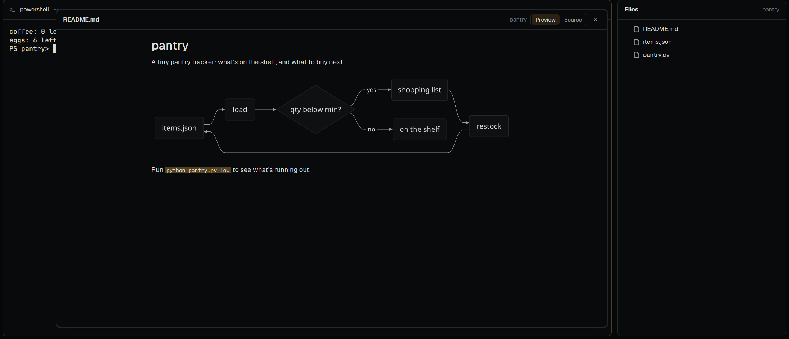

# Markdown Files

herdr's Files panel, with Markdown read as a document. The panel browses the focused pane's folder, on whichever
machine it's on; click a Markdown or `.mmd` file and it opens rendered in a floating window: headings, lists, tables,
code, front matter, its images, and mermaid diagrams drawn in the theme's colours.



## Install

Ask your Herdr agent to add this mod, or copy `mods/markdown-files/` into `~/.config/herdr-app/mods/`. Then point your
layout's Files block at it, keeping the block's id `files` so herdr's clicks on it still land:

```json
{ "id": "files", "type": "block", "content": { "mod": "markdown-files" } }
```

It also opens on one file anywhere herdr opens a mod: `pane.split { mod: "markdown-files", props: { file } }`.

## What you see

- **Panel:** a header with the folder's name, then the folder as a lazy tree (folders open on click, `.git` left
  out, at most 500 entries a folder and 5,000 in all), files marked by their git status when the folder is in a
  repository: A (added or untracked, green), M (modified, amber), D or U (deleted or conflicted, red).
- **A Markdown file** (`.md`, `.markdown`, `.mdown`, `.mkd`, `.mkdn`) or a mermaid file (`.mmd`, `.mermaid`) opens in a floating window
  (60% by 82% of the app), headed by the file's name, the folder, **Preview | Source** and ×. Preview is the document:
  prose (headings, lists, quotes, inline code, links) through gpui's Markdown text view, GFM tables, fenced code in
  titled boxes, front matter as a box, images, and ```` ```mermaid ```` blocks as diagrams. Source is the
  text in a read-only editor. One window at a time; it reopens where it was last dropped, and the panel stays on its
  folder.
- **Other files** preview in the panel itself as read-only source with syntax colours (up to 400 KB), with ← back.
  Binary, unreadable or larger files say they can't be previewed.

Colours come from the active theme; diagrams take the theme's colours too.

## How it behaves

- **Folder:** the focused pane's folder (its live `cwd`), else the space's. Switching panes switches the tree, and each
  folder keeps which subfolders were open and which file was shown. The tree refreshes when files change
  (`watchFolder`).
- **Other machines:** a pane on another machine lists and reads that machine's files (`exec(…, { on })`).
- **Links:** web links open in the system browser; links to other Markdown files open them in the window.
- **Images:** a file beside the document (on its machine), an absolute path, or a `data:` URI; each is copied into the
  cache so `image()` can draw it. Web addresses are never fetched: they show as links.
- **Diagrams:** drawn by [Pele](https://github.com/obsidianmd/pele) and cached by their code and colours, so a document
  opens with its diagrams at once the second time.
- **Props:** `{ file, on? }` makes it a viewer for that one file (and machine) instead of the focused folder; the
  floating window is this.

## Built from

**Mod** `mods/markdown-files/` (`mod.json` is `{ "place": "none" }`; built from the repository's `src/markdown-files` by
`scripts/package.py`), started from herdr's shipped `files` mod:

| Path | Role |
|---|---|
| `main.js` | the panel: the folder's tree, git marks, previews, the floating window and Preview/Source |
| `parse.js` | which files read as Markdown or mermaid, Markdown parsed into blocks, links resolved |
| `markdown.js` | the blocks drawn as a document: text, tables, code, front matter, images, diagrams |
| `images.js`, `bytes.js` | images copied into the cache, their type and size sniffed from their bytes |
| `diagrams.js`, `vendor/pele/` | mermaid through Pele, pinned in the repository's `package.json` and copied into `vendor/` (don't edit it) |
| `layout.js`, `hash.js`, `open-url.js` | shared helpers from the repository's `src/shared` |
| `icons/` | the mod's SVG icons (from the repository's one set, `src/shared/icons`) |

`herdr` functions: `spaces`, `panes`, `focused`, `exec`, `readTextFile`, `watchFolder`, `theme`, `settings`, `window`,
`appHome`, `props`, `openOverlay`, `closeOverlay`.

## Watch out

**What it accesses:**

- runs programs, on this computer and on the machine of the focused pane (`exec(…, { on })`): `powershell` or `sh` to
  list folders and read images, `git` (`rev-parse`, `status`) for the marks, `python3` or `base64` to decode saved
  images, and the system's opener (`rundll32`, `open`, `xdg-open`) for a link you click;
- reads the files in the folders it shows, and images a document points to;
- writes image copies under `cache/markdown-files/images/` and drawn diagrams under `cache/diagrams/` in the Herdr home
  (delete those folders along with the mod to remove everything);
- reaches the network only when you click a web link, through your browser.

**Notes for building it:**

- herdr's `fs.writeFile` writes binary data as an empty file while reporting success, and its `Buffer` encodes bytes to
  base64 as an empty string. Save each image, check it reads back whole, and when it doesn't, write it as base64 text
  (`toBase64` in `bytes.js`) for PowerShell, else Python 3 or `base64`, to decode beside it.
- `image()` draws files inside the Herdr home only, hence the cache.
- Windows PowerShell uses the console code page unless told otherwise; set UTF-8 output before listing a folder.
- Links keep their directory attribute even when dangling, so check a link's target before treating it as a folder.
- Write diagrams' theme colours into Pele's SVG directly; herdr's SVG renderer draws inline colours.
- Sizes from `on_size_change` include the app's zoom; layout sizes take unzoomed px.

## Done when

- `herdr-app check ~/.config/herdr-app/mods/markdown-files` passes and `herdr-app status` shows no errors.
- The panel lists the focused pane's folder, follows the focus to another pane, and marks changed files in a repository.
- A Markdown file opens rendered in the floating window, with its images and a mermaid block drawn as a diagram in the
  theme's colours; Source shows its text.
- A pane on another machine lists that machine's files.
